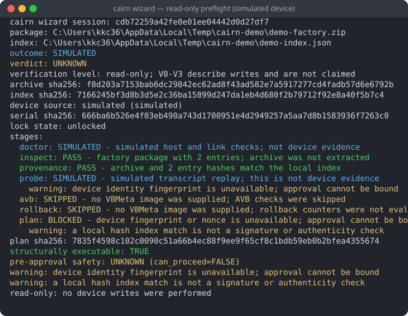
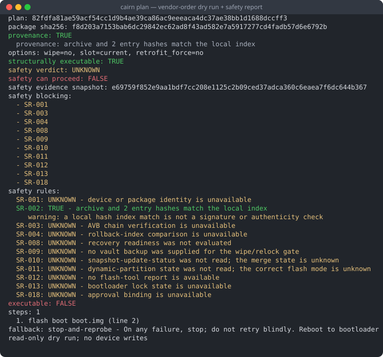
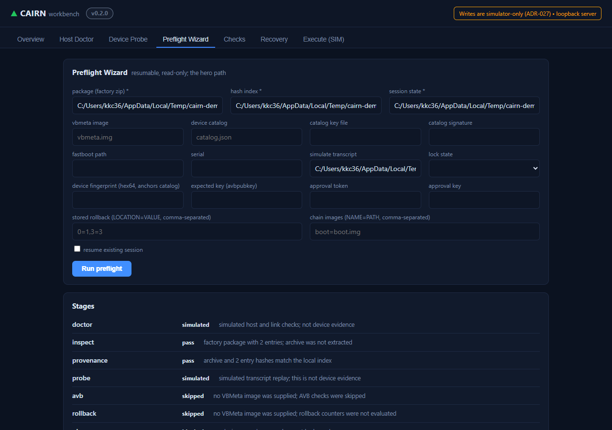
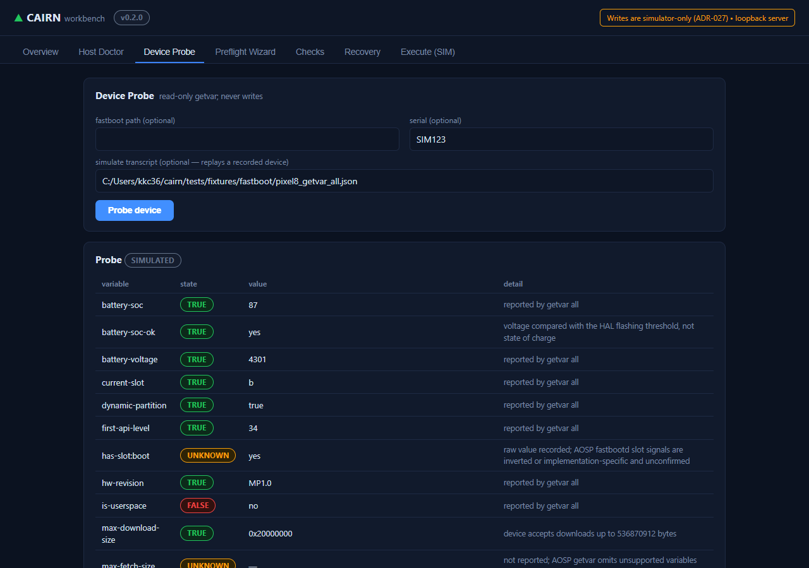
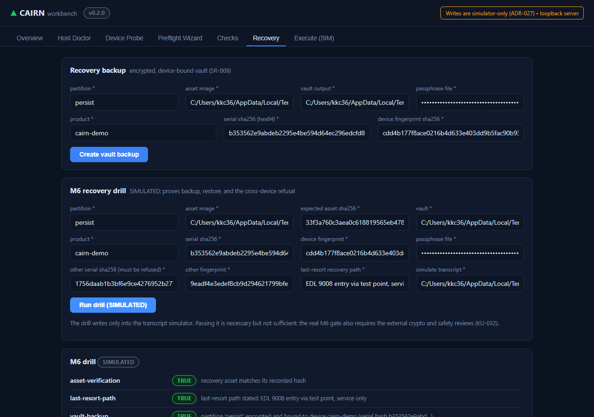
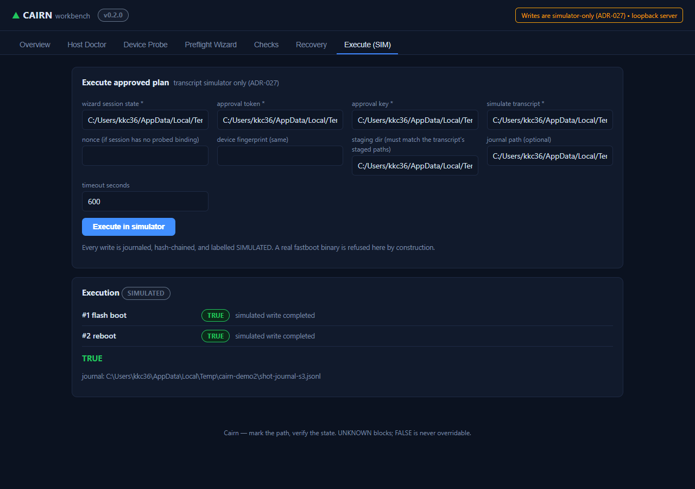
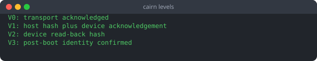

# Cairn

**Mark the path. Verify the state.**

[](https://github.com/hassan200503/cairn/actions/workflows/ci.yml)


Cairn is a fail-safe Android flashing workbench. It refuses unsafe jobs before the
first write, verifies every write at a stated level, journals every step so an
interrupted job can resume, and checks that a recovery path exists before taking
risk.

> Cairn (n.): a stack of stones that marks a proven path across uncertain ground.
> Every flash leaves a cairn behind: evidence of where you have been and how to get
> back.

**Status: alpha.** The full preflight → plan → safety-gate → approve → execute →
journal pipeline is implemented and tested (627 tests, 7 CI jobs including two
official AOSP oracles). Every write path is gated to the transcript simulator
(ADR-027); a real-device write transport does not exist and will not exist until
the M6 gate passes (external reviews + hardware evidence, tracked in
[KNOWN_UNKNOWNS.md](docs/KNOWN_UNKNOWNS.md)).

---

## Table of contents

- [Why](#why)
- [The promise](#the-promise)
- [Screenshots](#screenshots)
- [Install](#install)
- [Quickstart](#quickstart)
- [Verification levels](#verification-levels)
- [The safety model](#the-safety-model)
- [What is implemented](#what-is-implemented)
- [Command surface](#command-surface)
- [Repository map](#repository-map)
- [Development](#development)
- [Scope order](#scope-order)
- [What Cairn will never do](#what-cairn-will-never-do)
- [Documentation](#documentation)
- [License](#license)

## Why

Phones are physical devices on cables. "Almost impossible to fail" is a direction,
not a state. A failed flash has three failure domains — the package, the host link,
and the device's own state — and most flashing tools reason about only the first.
Cairn measures and reports all three, and it refuses to guess:

- unsafe jobs are refused **before** any write, with named rules and citations;
- every write is verified at a **named level** (V0–V3), never a bare "verified";
- every interruption is **resumable or provably safe** via a hash-chained journal;
- a recovery path is **checked before risk is taken**, and critical partitions are
  backed up into an encrypted, device-bound vault first.

It does not promise that nothing can go wrong. It promises to **fail safe, not fail
never**, and to never hide which of the two happened.

## Screenshots

The read-only preflight wizard runs eight stages over a package, a hash index, and
a device probe — simulated here by replaying a recorded transcript, and labeled as
such at every line:

<p align="center">
  
</p>

`cairn plan` produces a canonical-hash vendor-order dry run plus a separate safety
report. Every rule it cannot evaluate is an explicit `UNKNOWN` block — Cairn never
invents a fact to pass a gate:

<p align="center">
  
</p>

### The local workbench UI

`cairn ui` serves the same audited core as a loopback-only dashboard with
tri-state colour semantics — green `TRUE` = proven, red `FALSE` = unsafe and
never overridable, amber `UNKNOWN` = blocks. Screenshots below are real
headless-browser captures of the dashboard running the demo transcript
simulator (ADR-027: every write is SIMULATED).

The preflight wizard tab — the hero path, resumable and read-only:

<p align="center">
  
</p>

The device probe tab — read-only `getvar` facts with tri-state evidence pills:

<p align="center">
  
</p>

The recovery tab — vault backup plus the M6 drill, which proves the same-device
restore and the cross-device refusal (both green) in the simulator:

<p align="center">
  
</p>

The execute tab — an approved plan running in the transcript simulator with a
hash-chained journal:

<p align="center">
  
</p>

## Install

**Windows installer (recommended):** download `CairnSetup-<version>.exe` from the
latest [GitHub release](https://github.com/hassan200503/cairn/releases/latest)
and run it. It installs per-user (no admin), adds Cairn to your PATH, and puts a
**Cairn Workbench** shortcut in the Start Menu that opens the local dashboard.
The installer is unsigned (KU-034): SmartScreen will ask for confirmation on
first run. Rebuild it yourself from source with `tools/installer/build.ps1`
(requires PyInstaller and Inno Setup 6).

**From source** — requires Python 3.12+ and [uv](https://docs.astral.sh/uv/):

**Windows (PowerShell):**

```powershell
git clone https://github.com/hassan200503/cairn.git
cd cairn
./install.ps1
```

**Linux/macOS:**

```console
git clone https://github.com/hassan200503/cairn.git
cd cairn
./install.sh
```

Both scripts install the CLI as an isolated `uv tool` and run `cairn version` to
confirm. Upgrade with `git pull` and re-running the script (`--force` is included).

**Manual install** (or inside a development checkout):

```console
uv tool install --from . cairn-flash      # install the CLI from source
# or
uv sync                                   # dev environment with test tooling
uv run cairn version
```

Releases are tagged on GitHub with built wheels and sdists under
[Releases](https://github.com/hassan200503/cairn/releases).

## Quickstart

Everything below is read-only on a real device. The only write paths are
simulator-gated and labeled `SIMULATED`.

```console
# What is this host? WSL/VM detection, USB controllers, tool versions, link soak.
cairn doctor [--serial <serial>] [--soak 5]

# What is this device? Read-only getvar probe; never writes.
cairn probe [--serial <serial>] [--fastboot <path>]

# Record the full read-only probe checklist from a real device into a
# scrubbed transcript plus a hardware-finding draft (serials cannot survive).
cairn probe --capture ./capture-out

# What is this package? Inspect without extracting; hash every entry.
cairn inspect factory.zip --hash
cairn provenance factory.zip --index index.json

# Should this job run at all? Vendor-order dry run + safety report.
cairn plan factory.zip --index index.json

# Trust chain: AVB headers, digests, signatures, chained keys.
cairn avb info vbmeta.img
cairn avb verify vbmeta.img --key key.avbpubkey --chain boot=boot.img
cairn avb key-check vbmeta.img --key key.avbpubkey --lock-state locked
# ...or anchor the expected key from a source-cited device catalog:
cairn catalog check catalog.json
cairn avb key-check vbmeta.img --catalog catalog.json --product shiba --lock-state locked

# Rollback safety: can this package lower the anti-rollback counter?
cairn rollback read --serial <serial>
cairn rollback check vbmeta.img --device --serial <serial>

# Virtual A/B state gates.
cairn vab status --serial <serial>
cairn vab dynpart --mode fastbootd --serial <serial>

# The full resumable preflight: doctor → inspect → provenance → probe →
# avb → rollback → plan → approval, persisted to a strict session file.
cairn wizard factory.zip --index index.json --state session.json --serial <serial> \
    --vbmeta vbmeta.img --catalog catalog.json

# Execute an approved plan — in the transcript simulator only (ADR-027):
cairn approval issue ... && cairn execute --state session.json --simulate writes.json ...

# Recovery kit: back up critical partitions, verify, drill the M6 gate.
cairn recovery backup --partition persist --asset persist.img --out vault.json \
    --product shiba --serial-sha256 <hex> --device-fingerprint <hex> --passphrase-file pf.txt
cairn recovery drill --partition persist --asset persist.img --expected-sha256 <hex> \
    --vault vault.json --last-resort "EDL 9008 + signed factory image" \
    --simulate writes.json --other-serial-sha256 <hex> --other-fingerprint <hex> \
    --product shiba --serial-sha256 <hex> --device-fingerprint <hex> --passphrase-file pf.txt
```

## Verification levels

The word "verified" is never printed without a level.

| Level | Meaning |
| --- | --- |
| V0 | Transport acknowledged the write. |
| V1 | Host-side source hash matched the manifest, and the device acknowledged. |
| V2 | Device read-back hash matched the source (where the device supports it). |
| V3 | Post-boot identity was confirmed (bootloader slot signals, adb fingerprint, or a user-confirmed first boot). |

Fastboot tops out at V1 for general partitions: there is no generic partition
read-back in the fastboot protocol, and AOSP's `fetch` is restricted to
`vendor_boot` on debuggable, unlocked devices. The report says so instead of
pretending otherwise.

<p align="center">
  
</p>

## The safety model

Cairn's engine reasons over **tri-state facts** (`TRUE`, `FALSE`, `UNKNOWN`) with
provenance, observation time, and freshness bounds. `FALSE` is never overridable;
`UNKNOWN` blocks. The rules (full definitions in
[SAFETY_RULES.md](docs/SAFETY_RULES.md)):

| Rule | Gate | Block behavior |
| --- | --- | --- |
| SR-001/002 | package/device identity, hash-index provenance | UNKNOWN blocks |
| SR-003 | AVB chain of trust verified | UNKNOWN blocks |
| SR-004/005 | rollback index cannot decrease | unknown stored index is a hard stop |
| SR-008 | recovery assets verified before wipe/relock | FALSE/UNKNOWN block |
| SR-009 | critical partitions backed up in the device-bound vault | no backup, no wipe/relock |
| SR-010 | Virtual A/B merge state is `none` | mid-merge is never overridable |
| SR-011 | dynamic-partition mode matches the job | bootloader-vs-fastbootd mismatch blocks |
| SR-013 | lock state known and trusted-key checks pass | UNKNOWN blocks |
| SR-018 | approval token binds plan, package, device, and tools | any byte change invalidates |

Safety properties that are tested, not just claimed:

- **Approval binding** (SR-018): the token HMAC-signs the plan hash, evidence
  snapshot, archive hash, every package entry hash, the device binding, and tool
  identities. The executor re-verifies every staged image against the binding at
  execution time (TOCTOU guard).
- **Write-ahead journal**: append-only, hash-chained, fsync-per-record; a crash at
  *every* journal point is covered by a harness that proves each resume reaches the
  exact uninterrupted final state. Interrupted reboots are never re-run blindly.
  Long plans rotate to verified continuation journals instead of growing unbounded.
- **Pre-write reconciliation**: before the first write, the executor reads
  `snapshot-update-status` and `current-slot` and aborts on a mid-merge device.
- **Recovery vault** (format v2, ADR-029): PBKDF2-HMAC-SHA256 (600k iterations),
  encrypt-then-MAC, device-bound, restore-only-same-device — a cross-device restore
  is refused unconditionally, never overridably.
- **Mutation testing**: every safety rule and every approval-binding check is
  proven killed by the suite (`python tools/mutation_check.py`, currently 48/48).
- **Official oracles in CI**: the sparse-image parser is differentially tested
  against AOSP `libsparse`, and the super-metadata parser against `lpmake` built
  from pinned AOSP source.

## What is implemented

- ✅ Host Doctor (WSL/VM, USB, drivers, power policy, link soak)
- ✅ Read-only fastboot transport + full probe-capture with serial scrubbing
- ✅ fastboot-info v1 parser, factory/OTA zip inspection (no extraction)
- ✅ Offline hash-index provenance
- ✅ AVB parser, signature + chain verification, contextual expected-key check,
  catalog-anchored keys
- ✅ Vendor-order planner with canonical plan hash
- ✅ Rollback oracle + vendor stored-index reader
- ✅ Safety engine (13 rules) with override policy
- ✅ Approval keygen/issue/verify with full input binding
- ✅ Simulator-gated executor with crash-safe journal, resume, and VAB
  reconciliation
- ✅ Recovery vault (encrypted, device-bound) + M6 drill (simulated)
- ✅ Virtual A/B merge-state and dynamic-partition gates; modeled
  snapshot cancel/merge flows
- ✅ Super-metadata parser, differentially tested against pinned-source AOSP lpmake
- ✅ Resumable preflight wizard with strict session persistence
- ⏳ Real-device write transport — **blocked behind the M6 gate** (external
  crypto/safety review + real hardware evidence; see
  [REVIEW_BUNDLE.md](docs/REVIEW_BUNDLE.md))
- ⏳ Samsung / EDL / MediaTek backends — research-only, no hardware yet

## Command surface

Run `cairn --help`, or `<command> --help` for each. The full table with exit codes
is in [docs/STATE.md §4](docs/STATE.md).

| Command | Purpose |
| --- | --- |
| `cairn doctor` | read-only host checks + bounded `getvar` link soak |
| `cairn probe` | read-only `getvar all` probe; `--capture DIR` records the finding checklist with serial scrubbing |
| `cairn inspect` | read-only factory/OTA zip inspection |
| `cairn provenance` | match a package against a local hash index |
| `cairn plan` | vendor-order dry run + full safety report |
| `cairn wizard` | resumable read-only preflight session |
| `cairn approval` | keygen / issue / verify / inspect approval tokens |
| `cairn avb` | info / digest / verify / key-check |
| `cairn catalog` | validate source-cited device catalogs |
| `cairn rollback` | read / check rollback counters |
| `cairn vab` | status / dynpart / cancel / merge (cancel & merge simulator-only) |
| `cairn execute` | run an approved plan in the simulator with a write-ahead journal |
| `cairn recovery` | backup / verify / restore / drill |
| `cairn ui` | local workbench dashboard on `127.0.0.1` (loopback only; tri-state evidence view) |

Exit codes: `0` ok, `1` failed, `2` usage, `3` blocked or UNKNOWN.

## Repository map

```text
src/cairn/
  core/          tri-state logic, evidence graph, verification levels, errors
  tools/         bounded subprocess runner and pinned tool manifest
  sparse/        AOSP sparse format primitives, validation, libsparse oracle
  adapters/      read-only device transports + probe capture (scrubbed transcripts)
  catalog/       device catalog: source-cited anchoring records
  host/          Host Doctor: drivers, USB, power, virtualization, link soak
  package/       fastboot-info and factory/OTA package inspection
  plan/          read-only vendor-order planner and plan hash
  provenance/    hash index, AVB parsing, chain verification, lock/key trust
  rollback/      rollback oracle + vendor stored-index reader
  safety/        safety rule engine and override policy
  approval/      HMAC approval tokens and input binding
  wizard/        resumable preflight stages, strict session persistence
  executor/      simulator-gated executor, hash-chained write-ahead journal
  recovery/      encrypted device-bound vault, asset checks, M6 drill
  vab/           merge-state gate, dynamic-partition gate, snapshot flows, super metadata
  ui/            loopback-only local dashboard (ADR-031) over the audited core
  sim/           transcript schema and fault-injecting fastboot simulator
docs/            specification, safety rules, ADRs, known unknowns, hardware findings
tools/           mutation harness and AOSP oracle builders
tests/           627 tests; fixtures from scrubbed real transcripts
```

## Development

```console
uv sync
uv run ruff format .        # format
uv run ruff check .         # lint
uv run mypy src             # strict types
uv run pytest -q            # 627 tests
python tools/mutation_check.py   # safety-rule mutation harness (48/48 killed)
```

CI (`.github/workflows/ci.yml`) runs seven jobs on every push: lint + types, the
AOSP libsparse oracle, the AOSP lpmake differential oracle (built from pinned
source), and the test matrix on Ubuntu and Windows, Python 3.12 and 3.14. A change
is not done until all gates pass and the docs are updated in the same commit.

## Scope order

1. Qualcomm/fastboot class (AOSP-documented; proves the core).
2. `adb sideload` and `update_engine` (cheap, safe, broad).
3. Samsung with a pluggable backend and explicit Knox warnings.
4. EDL and MediaTek as Assisted tier.
5. Unisoc analysis only.

Samsung's 2026 Maintenance Mode gate, and the fact that Download Mode may be
unreachable when Android cannot boot, make Samsung a recovery-risk market rather
than a first target. That is recorded, not hand-waved.

## What Cairn will never do

No FRP bypass. No IMEI changes. No carrier-lock circumvention. No loader
authentication bypass. No signature-check defeat. No cross-device data transplant.
Restoring a device's own backed-up data to that same device is allowed and is
exactly what the vault and drill exist for.

## Documentation

| Document | Contents |
| --- | --- |
| [docs/STATE.md](docs/STATE.md) | canonical current state — start here |
| [docs/SPEC_V2.md](docs/SPEC_V2.md) | the reviewed v2 specification |
| [docs/SAFETY_RULES.md](docs/SAFETY_RULES.md) | every rule, its tri-state defaults, and sources |
| [docs/DECISIONS.md](docs/DECISIONS.md) | architecture decision records (ADR-001 … ADR-029) |
| [docs/KNOWN_UNKNOWNS.md](docs/KNOWN_UNKNOWNS.md) | what is not known yet, and what would resolve it |
| [docs/EXECUTION_PLAN.md](docs/EXECUTION_PLAN.md) | workstreams T01–T30, gates, definition of done |
| [docs/ROADMAP.md](docs/ROADMAP.md) | milestones M0–M12 |
| [docs/RECOVERY_THREAT_MODEL.md](docs/RECOVERY_THREAT_MODEL.md) | the recovery threat model |
| [docs/REVIEW_BUNDLE.md](docs/REVIEW_BUNDLE.md) | the external review package (KU-032) |
| [docs/HARDWARE_FINDINGS.md](docs/HARDWARE_FINDINGS.md) | findings from real device runs |

## License

Apache-2.0 for the core. The signed device catalog is intended to be a separate
commercial asset. Tools invoked as separate processes keep their own licenses:
Heimdall is MIT, Thor is MPL-2.0, and bkerler/edl and mtkclient are GPL-3.0 —
Cairn never links or vendors their code.
